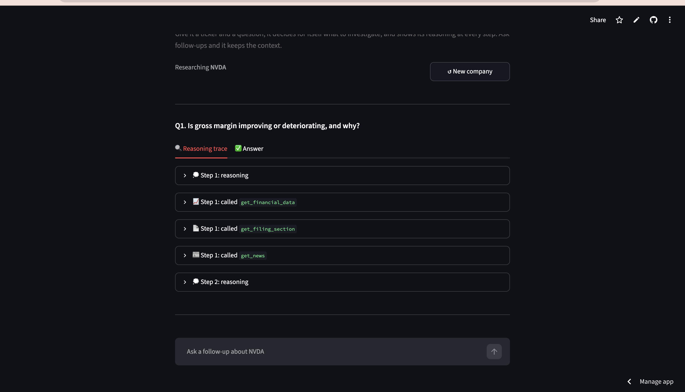

# Autonomous Financial Research Agent

Given a ticker and a research question, this agent decides for itself what to investigate, pulls real data via tool calls, evaluates whether it has enough evidence, and either keeps investigating or writes up findings with sources, instead of following a fixed, scripted pipeline.

**[Try it live](https://research-agent-kvscuabrek3qeus3kdcxvu.streamlit.app/)** · Python · Anthropic Claude API · yfinance · SEC EDGAR




## Why an agentic loop, not RAG

Most "AI + finance" projects retrieve a fixed set of documents once and summarize them. This agent instead runs a real plan, act, observe, replan loop: at each step, Claude decides which tool(s) to call based on what it has learned so far, not a hardcoded sequence. That decision-making, visible in the reasoning trace, is the actual differentiator.

## Architecture

**Tools** (all real, live data, no mocked responses):

- `get_financial_data` pulls quarterly financial metrics (e.g. gross margin) via Yahoo Finance, computing derived metrics (like margin ratios) from raw line items
- `get_news` pulls recent company news, filtered for relevance to a topic via a single batched Claude call (not per-article, to control cost)
- `get_filing_section` pulls a specific section (e.g. Risk Factors, MD&A) from a company's latest SEC 10-K filing, parsed and cleaned from raw HTML

**Loop control:**

- Hard-capped at 5 tool-call steps before the agent must answer with what it has, and forced to actually synthesize an answer at that point rather than stall
- Handles parallel tool calls correctly (Claude often requests multiple independent tools in a single step, confirmed via live testing that every `tool_use` block requires a matching `tool_result` or the API rejects the whole request)
- Every step logs what was called, why, and what came back. This is the reasoning trace.

**A real trust safeguard, found and fixed during testing:** Early runs showed Claude generating confident-sounding explanations even when no supporting news was found, presenting inference as if it were a data-backed finding. Fixed with a standing system instruction requiring any unconfirmed reasoning to be explicitly labeled `"Inferred (not confirmed by available data):"`, kept clearly separate from tool-grounded findings. An agent that is honest about the limits of its own evidence is a stronger result than one that always sounds equally sure of itself.

## Evaluation

Batch-tested across 10 companies (NVDA, AAPL, MSFT, TSLA, JPM, KO, AMZN, META, GOOGL, DIS) and 3 question types (gross margin trend, risk factors, revenue growth):

| Metric | Result |
| --- | --- |
| Completion rate | 100% (30/30 queries) |
| Average reasoning steps | 1.7 |
| Average latency | 10.1 seconds per query |
| Accuracy spot-check | NVDA and AAPL outputs manually cross-referenced against SEC 10-K filings; cited figures and reasoning matched filing language in both cases |

**A failure found after the batch test, and fixed.** Asked whether revenue growth was slowing at Somnigroup (SGI), the agent compared adjacent quarters, saw a Q3 peak followed by three lower quarters, and reported a "clear downward trend" with full confidence. The Q3 peak was Labor Day seasonality, which is structural for a mattress retailer, not deterioration. Year over year the same quarter was down roughly 3%, a much weaker claim. The system prompt now requires year-over-year comparison for any growth or trend question and requires the agent to state which basis it used. The durable fix is to compute the comparison in `tools.py` rather than asking the model to choose it, which is open work.

**What completion rate does and does not mean:** it measures whether the agent produced a synthesized answer without stalling or erroring, not whether every answer was correct. Accuracy was verified manually on a 2-company subset only. Broader accuracy testing is open work.

## Known limitations

- Accuracy verified on 2 of 10 companies, not all 10
- Capped at 5 tool-call steps, so genuinely multi-hop questions can hit the ceiling and answer from partial evidence
- `get_filing_section` parses the latest 10-K only, so it misses quarter-to-quarter changes in 10-Qs
- Context is held within a session only, so follow-ups work but a page reload starts cold; nothing persists across sessions
- yfinance is an unofficial API and occasionally returns stale or missing line items

## UI

A Streamlit front end (`app.py`) shows the full reasoning trace live as the agent works: each tool call, its input, and its result in an expandable step, plus a tabbed view separating the trace from the final answer. The conversation is multi-turn: after the first answer, follow-up questions reuse the full context, so the agent can be pushed on its own findings rather than restarted. Includes example question chips and a lightweight verdict badge (improving/deteriorating) based on the answer content.

## Example run

Question: *Is NVDA's gross margin improving or deteriorating, and why?*

The agent calls `get_financial_data` for the metric history and `get_news` for context in a single step, then answers:

> NVDA's gross margin is improving significantly. Gross margin rose from 60.5% (Q1 FY2025) to 74.9% (Q1 FY2026).
>
> Inferred (not confirmed by available data): the improvement likely reflects a favorable product mix shift toward high-margin AI accelerators, manufacturing scale efficiencies, and continued pricing power.

A second run, asking about AAPL's risk factors instead, correctly chose `get_filing_section` with `"risk factors"` (a different tool and section than the margin question) with no code changes, demonstrating the loop generalizes across companies and question types rather than being hardcoded to one scenario.

## Tech stack

Python, Anthropic Claude API (tool use / function calling), yfinance, SEC EDGAR (direct API), BeautifulSoup, Streamlit

## Running it

```bash
pip install -r requirements.txt
export ANTHROPIC_API_KEY="your-key-here"
```

Terminal version:

```bash
python3 research_agent_loop.py
```

UI version:

```bash
streamlit run app.py
```

## Status

v1, deployed. Core loop, all three tools, the trust-labeling safeguard, the year-over-year comparison constraint, and a multi-turn Streamlit UI are built, tested, and running live. Next: broader accuracy verification beyond the 2-company spot-check, moving the comparison logic out of the prompt and into the tools, 10-Q support, memory that persists across sessions, and consolidating the three copies of the research loop into one shared module.

## Author

Simran Parikh, Industrial & Systems Engineering @ Georgia Tech. [LinkedIn](https://linkedin.com/in/simran-parikh-848648271)
